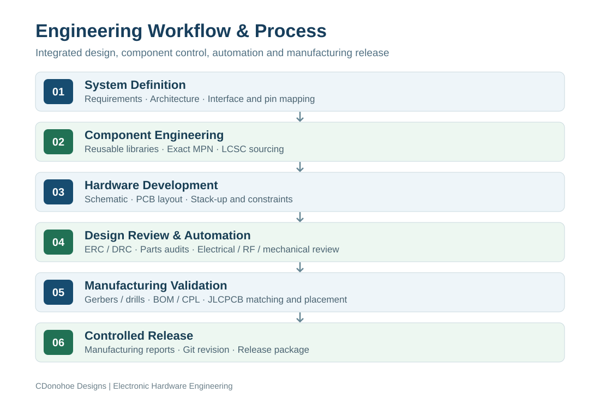

# Engineering Workflow & Manufacturing Process

**A repeatable approach to electronic hardware development — from system definition through manufacturing release.**

My engineering workflow combines hardware design, component engineering, design reviews, automation and manufacturing preparation. Component sourcing, reusable libraries, design checks and production deliverables are integrated throughout development.

## 1. System definition and architecture

Define the application, functional requirements, hardware architecture and interfaces. Select the MCU or module, establish pin assignments and identify power, sensing, communications, mechanical and manufacturing constraints early.

## 2. Component engineering and reusable libraries

Select production components using exact manufacturer part numbers, package specifications and supplier availability. Reuse qualified symbols, footprints and 3D models from shared KiCad libraries. Maintain manufacturer, MPN and LCSC part metadata in the design and parts catalogue.

## 3. Schematic and PCB development

Develop and review schematics, then implement the PCB with an appropriate layer stack-up, return paths, power distribution, RF clearances, connectors, mechanical interfaces and test access. Apply ERC and DRC throughout development.

## 4. Design review and engineering automation

Combine manual electrical, mechanical and RF reviews with Python-based audits for BOM completeness, component metadata, parts approval, library paths and design-rule results. Record and resolve review findings as the design progresses.

## 5. Manufacturing preparation and validation

Generate revision-specific Gerbers, drill files, assembly BOM and component placement lists (CPL). Check board dimensions, layer count, exact component matching, stock, assembly-side interpretation and placement using the JLCPCB manufacturing workflow. Capture the manufacturing reports alongside the released outputs.

## 6. Configuration management and release

Maintain dedicated design variants and revision-controlled deliverables in Git. Complete final reviews and audits, assemble the manufacturing package, and create the release commit, tag and portfolio documentation.

## Engineering toolchain

| Area | Tools and methods |
| --- | --- |
| Hardware design | KiCad, Altium Designer, schematic capture, multilayer PCB layout |
| Component engineering | Shared KiCad libraries, manufacturer/MPN metadata, LCSC sourcing, BOM/AVL |
| Design quality | ERC, DRC, manual electrical/mechanical/RF review, Python audits |
| Manufacturing | Gerbers, Excellon drills, BOM, CPL, JLCPCB assembly validation |
| Configuration management | Git branches, revisioned outputs, release tags |

## Example implementation — SenseLink

This workflow is applied in the modular **[SenseLink hardware platform](https://github.com/CDonohoe-Designs/SenseLink)**, where the design procedure includes existing-part-first sourcing, shared libraries, variant-specific audits and JLCPCB manufacturing validation.

[Read the detailed SenseLink Design & Manufacturing Workflow](https://github.com/CDonohoe-Designs/SenseLink/blob/main/docs/SENSELINK_DESIGN_WORKFLOW.md).

---

[Back to the Engineering Portfolio](../../README.md)
