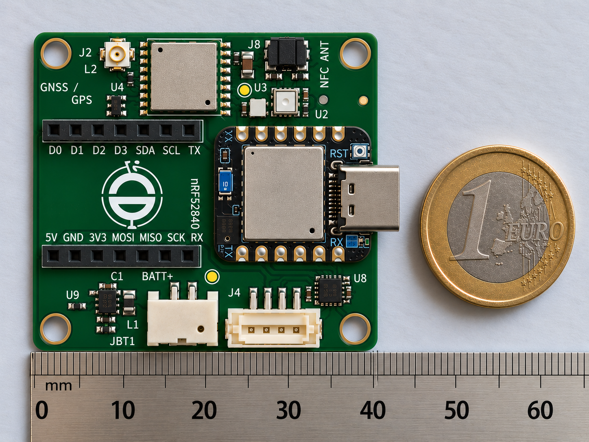

# Nordic nRF52840 — Hardware, Zephyr/NCS Firmware & BLE

**Embedded hardware and firmware engineering evidence across the Nordic nRF platform**



## Overview

This portfolio demonstrates practical Nordic embedded-system capability across hardware, PCB design, embedded firmware, BLE, sensor integration and production-oriented engineering.

The headline hardware project is **SenseLink X nRF52840 Rev A**, a custom wireless sensor and IoT platform built around the Seeed Studio XIAO nRF52840. Supporting firmware evidence comes from my wider Nordic/Zephyr development work using Nordic nRF Connect SDK, custom BLE GATT services, real sensors and Android BLE integration.

The aim is to show the complete engineering path from electronic architecture and PCB design through embedded firmware and wireless data delivery—not simply use of a development board.

## Core Engineering Capability

### Hardware

- Nordic nRF52840 platform integration
- KiCad schematic capture and PCB design
- Four-layer PCB architecture
- Battery-powered and low-power system design
- I²C, SPI and UART peripheral interfaces
- Sensor and peripheral integration
- GNSS integration
- NFC capability where supported by the platform
- USB-capable Nordic platform integration
- RF/antenna-aware PCB design
- Expansion interfaces
- Production test access
- DFM/DFT considerations
- Manufacturer/MPN/LCSC component control
- BOM, CPL, Gerber and drill manufacturing handoff
- JLCPCB-oriented sourcing and assembly preparation

### Firmware

- Embedded C
- Zephyr RTOS
- Nordic nRF Connect SDK (NCS)
- Devicetree
- Kconfig
- I²C sensor integration
- Custom BLE GATT services
- READ and NOTIFY characteristics
- Persistent configuration using Zephyr Settings/ZMS
- Structured sensor-data protocols
- Error/status/freshness reporting
- BLE debugging and interoperability testing

---

## SenseLink X nRF52840 Rev A

SenseLink X is a modular wireless sensor and IoT hardware platform designed around reusable sensing, power, expansion, GNSS, manufacturing and validation workflows.

The **nRF52840 Rev A** variant provides direct evidence of Nordic-focused hardware engineering. It applies the established SenseLink production-oriented workflow to the nRF52840 platform, with emphasis on capabilities that map directly to commercial embedded work: BLE, low-power operation, sensor integration, standard serial buses, RF-aware PCB design, production test access and manufacturing handoff.

### Platform architecture

```text
                    +----------------------+
                    |  XIAO nRF52840       |
                    |  Nordic nRF52840     |
                    +----------+-----------+
                               |
             +-----------------+-----------------+
             |                 |                 |
            I2C               SPI               UART
             |                 |                 |
          Sensors          Expansion        Peripherals
             |
             +-----------------+-----------------+
                               |
                        SenseLink Platform
                               |
              +----------------+----------------+
              |                |                |
            Power             GNSS          Test / I/O
```

The standard SenseLink/XIAO bus convention preserves the common XIAO interfaces where supported:

| XIAO pins | Function |
| --- | --- |
| D0–D3 | General add-on GPIO |
| D4 / D5 | I²C SDA / SCL |
| D6 / D7 | UART TX / RX |
| D8 / D9 / D10 | SPI SCK / MISO / MOSI |
| Additional pads | SenseLink-specific functions where available |

This keeps the platform compatible with common XIAO expansion hardware while allowing application-specific functions to be added without unnecessarily consuming standard buses.

---

## Hardware Engineering

The nRF52840 design is intended to demonstrate a complete hardware workflow rather than a schematic-only exercise.

### Electrical architecture

The design work covers:

- Nordic nRF52840 wireless processing platform
- battery-powered embedded operation
- power distribution and decoupling
- sensor interfaces
- I²C/SPI/UART connectivity
- GNSS subsystem integration
- NFC support where appropriate
- general-purpose expansion
- production test access
- connector and mechanical integration

### PCB engineering

The SenseLink workflow uses a deliberate four-layer architecture where appropriate:

```text
L1  Components + signals
L2  Continuous ground reference
L3  Power distribution
L4  Signals + local copper
```

PCB review includes antenna/RF clearance, reference-plane continuity, connector access, battery polarity/access, module placement, expansion-header alignment, sensor placement, mounting-hole clearance, board-edge clearance, component height, silkscreen readability and production-test accessibility.

This is particularly important for wireless embedded hardware: passing DRC is only one part of producing a manufacturable RF-capable board.

---

## Component & Library Engineering

SenseLink uses a controlled reusable-library and sourcing workflow rather than copying arbitrary symbols and footprints into each project.

Reusable components are maintained in shared KiCad libraries, while SenseLink/XIAO-specific assets remain local to the SenseLink platform.

Production components are tracked using engineering metadata including:

- manufacturer
- exact manufacturer part number
- LCSC part number where applicable
- datasheet/reference documentation
- validated symbol
- validated footprint
- 3D model where appropriate

LCSC/JLCPCB availability is considered during component selection, and EasyEDA/LCSC assets can be imported and then verified when suitable.

---

## Design Verification & Manufacturing Handoff

The engineering workflow is:

```text
Requirements
     ↓
Platform / MCU investigation
     ↓
Pin-map freeze
     ↓
Component selection & sourcing
     ↓
Schematic design
     ↓
PCB layout
     ↓
ERC / DRC
     ↓
Electrical / mechanical / RF review
     ↓
Component metadata audit
     ↓
BOM / CPL / Gerbers / drills
     ↓
Manufacturing review
     ↓
Git-controlled release
```

The SenseLink audit tooling checks component metadata, library and 3D-model paths, ERC/DRC status and variant review information. Manufacturing outputs are kept variant- and revision-specific to provide a traceable handoff from design source to fabrication and assembly data.

---

## Nordic Zephyr / nRF Connect SDK Firmware

My Nordic firmware development uses:

**Nordic nRF Connect SDK | Zephyr RTOS | Embedded C | Devicetree | Kconfig | BLE GATT**

The wider Nordic development work provides firmware evidence complementary to the nRF52840 hardware design.

Implemented functionality includes:

- custom BLE environmental service
- multiple GATT characteristics
- characteristic READ operation
- BLE NOTIFY operation
- structured/versioned environmental records
- configurable sampling interval
- persistent configuration using Zephyr Settings/ZMS
- real I²C sensor acquisition
- sensor error reporting
- status flags
- sample sequence tracking
- sample-age/freshness information
- Android BLE testing
- ATT MTU and long-record behaviour investigation

A **44-byte version-1 environmental data record** has been implemented and hardware-tested on Nordic hardware using real sensor measurements.

The record carries information including:

- protocol version
- status flags
- sample sequence
- sample age
- active sampling interval
- sensor error state
- temperature
- relative humidity
- pressure
- raw gas resistance
- calculated dew point

This demonstrates BLE work beyond simply enabling advertising or exposing a single example characteristic.

---

## Sensor Integration

Nordic firmware development includes real I²C environmental sensing using a BME680, with measurements including:

- temperature
- relative humidity
- pressure
- raw gas resistance
- calculated dew point

Additional ambient-light integration has also been developed using the BH1750/GY-302 on the shared I²C bus.

The firmware architecture separates sensor acquisition, the environmental data model, persistent configuration and BLE transport so the design can be extended without coupling every sensor directly to the wireless protocol.

```text
Physical Sensors
       ↓
Sensor Drivers / I²C
       ↓
Environmental Data Model
       ↓
Status + Configuration + Persistence
       ↓
Custom BLE GATT Service
       ↓
Android / Web Bluetooth Client
```

---

## BLE to Application Integration

The Nordic BLE work has been exercised with Android using a browser-based Web Bluetooth application.

```text
Real Sensors
     ↓
Nordic Hardware
     ↓
Zephyr / nRF Connect SDK
     ↓
Custom BLE GATT
     ↓
Android BLE
     ↓
Live Environmental Data
```

This provides end-to-end evidence spanning sensor hardware, embedded firmware, BLE protocol design and application-level data delivery.

---

## Evidence Status

The portfolio deliberately distinguishes between different types of engineering evidence.

| Evidence | Meaning |
| --- | --- |
| **Designed** | Hardware/schematic/PCB engineering completed |
| **Firmware developed** | Embedded implementation completed |
| **Hardware validated** | Function exercised on physical hardware |
| **Calculated** | Performance derived from documented design assumptions/datasheet parameters |
| **Measured** | Result obtained experimentally from physical hardware |

The nRF52840 Rev A board is the primary **hardware-design evidence** in this portfolio. The Zephyr/NCS and custom BLE GATT work is supporting **Nordic firmware evidence** from the wider SenseLink/Nordic development work. Firmware portability to nRF52840 is not presented as physical validation on the nRF52840 Rev A assembly unless that specific test has been performed.

---

## Client-Relevant Deliverables

This work maps directly to typical embedded-hardware and Nordic BLE project requirements.

| Area | Capability / deliverable |
| --- | --- |
| Hardware architecture | MCU/module, power, sensors, interfaces, expansion |
| Schematic design | KiCad hierarchical design and documented interfaces |
| PCB design | Four-layer mixed digital/RF-aware layout |
| Component engineering | MPN/LCSC sourcing, footprints, metadata and availability |
| Firmware | Embedded C, Zephyr, NCS, Devicetree and Kconfig |
| Sensors | I²C integration, acquisition and error handling |
| BLE | Advertising, custom GATT, READ/NOTIFY, structured records |
| Configuration | Runtime configuration and persistent settings |
| Validation | Bring-up, sensor testing, BLE testing and debugging |
| Manufacturing | BOM, CPL, Gerbers, drills and assembly review |
| Handover | Git-controlled source and engineering documentation |

## What This Demonstrates

For a client looking for Nordic nRF expertise, this portfolio provides evidence that I can work across the complete embedded product stack:

**Electronic architecture → schematic → PCB → manufacturing data → embedded C/Zephyr → sensors → BLE GATT → application integration → validation**

The emphasis is on practical engineering deliverables: hardware that can be manufactured, firmware that interfaces with real devices, documented wireless protocols and a traceable path from design through verification and handoff.

---

**CDonohoe Designs — Embedded hardware, PCB design, Nordic/BLE, wireless IoT and production handoff.**
