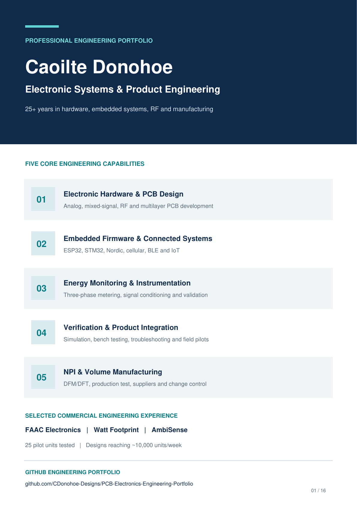

# Electronic Systems & Hardware Engineering Portfolio

**Mixed-Signal & RF Design | Energy Monitoring & Instrumentation | Embedded Systems | Product Development & Manufacturing**

A selection of commercial engineering experience and recent technical projects spanning electronic architecture, analogue and digital design, PCB development, connected sensing, verification, production engineering and field integration.

I am an electronic systems and product-development engineer with 25+ years of experience working from concept and component selection through schematic and PCB design, qualification, production testing and volume manufacture. My work combines hands-on hardware development with embedded C/C++, wireless communications, measurement systems and practical problem-solving across R&D, manufacturing and customer deployments.

<table>
  <tr>
    <td width="220" valign="top">
      
    </td>
    <td valign="top">
      <h2>Engineering Portfolio</h2>
      
The approved <strong>16-page Version 29</strong> portfolio covers commercial product development, hardware and embedded firmware, RF, verification, NPI and manufacturing. Commercial engineering experience includes <strong>FAAC</strong> RF hardware and volume manufacturing, <strong>Watt Footprint</strong> energy monitoring and 25 pilot units, and <strong>AmbiSense</strong> low-power optimization and sensing.

      
<a href="Portfolio/Engineering_Highlights/PCB_IoT_Solutions_Embedded_Engineering_Portfolio.pdf"><strong>View the Complete Engineering Portfolio (PDF)</strong></a>

    </td>
  </tr>
</table>

## Selected engineering projects

| Project | Engineering focus | Portfolio |
|---|---|---|
| **Engineering Workflow & Manufacturing Process** | Reusable component libraries, sourcing, automated audits, PCB review, JLCPCB manufacturing validation and controlled releases | [Workflow](Portfolio/Engineering_Workflow/README.md) |
| **STM32WL LoRa sensor board** | Sub-GHz RF, analogue input protection and conditioning, ADC/reference interfaces, sensor integration, power architecture and LTspice/Python analysis | [Portfolio (PDF)](Portfolio/STM32WL/PCB_IoT_Embedded_Engineering_Portfolio_STM32WL.pdf) |
| **USB 3.0 to Gigabit Ethernet — LAN7800** | Four-layer Altium PCB, high-speed routing constraints, completed schematic/PCB reviews, Rev A manufacturing evidence and document-control traceability | [Case study](Portfolio/LAN7800/README.md) · [Engineering evidence](https://github.com/CDonohoe-Designs/USB3-Gigabit-Ethernet-Adapter-Portfolio) |
| **EdgeLink S3 Cellular** | ESP32-S3/SIM7080G cellular and GNSS architecture, battery charging, power conversion, sensor integration and KiCad manufacturing preparation | [Portfolio (PDF)](Portfolio/EdgeLink_S3_Cellular/EdgeLink_S3_Cellular_Engineering_Portfolio.pdf) |
| **ExitLight Health Checker** | ESP32-based cellular IoT retrofit for automated emergency-light testing, with SIM800L, BH1750 light sensing, relay-controlled testing and AWS IoT/MQTT reporting | [Portfolio (PDF)](https://github.com/CDonohoe-Designs/IoT-Emergency-Light-Health-Monitoring-System/blob/main/Documentation/ExitLight_Health_Checker_Portfolio.pdf) |
| **Nordic nRF52840 BLE** | GNSS, LiPo power, sensors, KiCad PCB design, Zephyr/NCS and custom BLE GATT | [Portfolio (PDF)](Portfolio/Nordic_nRF52840/Nordic_BLE_Engineering_Portfolio_Green_Style_v14.pdf) |
| **ESP32-S3 wireless sensing** | Four-layer 41 × 41 mm PCB, GNSS, sensors, Wi-Fi/JSON telemetry and manufacturing preparation | [Portfolio (PDF)](Portfolio/ESP32S3/ESP32S3_Engineering_Portfolio_Complete_9Pages.pdf) |

Project overviews distinguish commercial product delivery from CAD, simulation and physical demonstrations. The STM32WL, LAN7800 and EdgeLink boards are CAD design projects; they are not presented as manufactured or physically validated boards. Nordic nRF52840 and ESP32-S3 firmware demonstrations use separate development hardware.

## Engineering capabilities

- **Hardware & measurement:** electronic architecture, analogue/digital and mixed-signal design, sensor signal conditioning, ADC/reference interfaces, three-phase metering and power profiling
- **PCB & RF:** schematic capture, multilayer PCB layout, RF/wireless design, high-speed interfaces, controlled impedance and signal/return-path considerations
- **Embedded & connected systems:** ESP32, STM32 and Nordic platforms; embedded C/C++, Zephyr, BLE, Wi-Fi, LoRa, cellular, MQTT/JSON and fault recovery
- **Product development & manufacture:** DFM/DFT, NPI, BOM/component control, manufacturing packages, production-test specifications, supplier coordination and ISO 9001 documentation
- **Verification & field engineering:** bench and RF measurement, environmental testing, LTspice/Python analysis, root-cause investigation, commissioning and customer-pilot support

## Browse the documents

[Portfolio document index](Portfolio/README.md) · [All repositories](https://github.com/CDonohoe-Designs?tab=repositories)

---

**CDonohoe Designs — Electronic systems, embedded hardware, RF/wireless, instrumentation and manufacturing engineering.**
